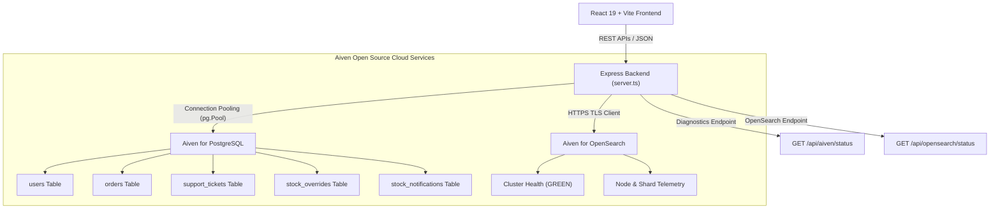

# FindKart — Powered by Aiven Open Source Services

FindKart's backend is powered by **Aiven Open Source Services**:
1. **Aiven for PostgreSQL** — Managed relational database for transactional consistency (users, orders, support tickets, inventory overrides).
2. **Aiven for OpenSearch** — Managed search and telemetry engine with strict TLS/HTTPS encryption.

---

## 1. Architecture Overview



---

## 2. Aiven Service Details

### A. Aiven for PostgreSQL (Open Source)
- **Engine Version:** PostgreSQL 18.7
- **Database:** `defaultdb`
- **Security:** TLS 1.3 encrypted connection
- **Connection Management:** `pg.Pool` connection pool with auto-reconnect and idle eviction

### B. Aiven for OpenSearch (Open Source)
- **Cluster Health:** GREEN
- **Security:** Strict HTTPS TLS certificate verification (`rejectUnauthorized: true`)
- **Telemetry:** Live cluster health, latency, node counts, and shard metrics

---

## 3. Database Schema & Tables

All tables and indexes are defined in [`backend/schema.sql`](file:///c:/Users/jeevan/OneDrive/Desktop/findkart-backend/find-kart-hackathon/backend/schema.sql) and migrated to Aiven on startup:

| Table Name | Description | Key Columns / Types |
| :--- | :--- | :--- |
| `users` | User accounts & state | `id` (PK), `email` (unique index), `password_hash`, `cart` (JSONB), `wishlist` (JSONB) |
| `orders` | Completed checkouts & shipment | `order_id` (PK), `user_id` (FK), `items` (JSONB), `shipping` (JSONB), `total` |
| `support_tickets` | Customer care complaints & SLA | `ticket_id` (PK), `status`, `sla_due_at`, `assigned_specialist`, `replies` (JSONB) |
| `stock_overrides` | Real-time catalog inventory | `product_id` (PK), `stock` (integer), `updated_at` |
| `stock_notifications` | Restock alerts for customers | `id` (PK), `product_id`, `email`, `status`, `created_at` |

---

## 4. Live Diagnostics Endpoints

### 1. `GET /api/aiven/status` (PostgreSQL Status)
Returns real-time PostgreSQL health, database sizing, active connections, and table metrics:
```json
{
  "service": "Aiven for PostgreSQL (Open Source)",
  "provider": "Aiven",
  "connected": true,
  "latencyMs": 246,
  "database": "defaultdb",
  "version": "PostgreSQL 18.7",
  "databaseSize": "8318 kB",
  "activeConnections": 2
}
```

### 2. `GET /api/opensearch/status` (OpenSearch Status)
Returns live OpenSearch cluster health, latency, node counts, and shard status:
```json
{
  "status": "connected",
  "connected": true,
  "clusterHealth": "green",
  "latencyMs": 689,
  "numberOfNodes": 1,
  "activeShards": 4
}
```

---

## 5. Verification Commands

### Test PostgreSQL Connection & Migrations:
```bash
npm run db:init
```

### Test OpenSearch Cluster Health:
```bash
npm run opensearch:status
```

### Start Development Server:
```bash
npm run dev
```

### Live Browser Endpoints:
- Health check: `http://localhost:3000/api/health`
- Aiven PostgreSQL status: `http://localhost:3000/api/aiven/status`
- Aiven OpenSearch status: `http://localhost:3000/api/opensearch/status`
