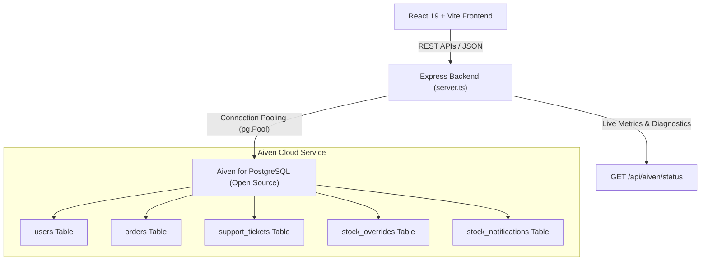

# FindKart — Powered by Aiven Open Source PostgreSQL

FindKart's backend is powered by **Aiven for PostgreSQL**, a fully-managed cloud database service built on 100% open-source PostgreSQL.

---

## 1. Architecture Overview



---

## 2. Aiven Service Details

- **Service Type:** Aiven for PostgreSQL (Open Source)
- **Host:** `pg-1502d993-findcart10.c.aivencloud.com:10969`
- **Database:** `defaultdb`
- **SSL Security:** TLS 1.3 encrypted with automated CA chain handling
- **Connection Management:** `pg.Pool` connection pool with auto-reconnect and idle eviction

---

## 3. Database Schema & Tables

All tables and indexes are defined in [`backend/schema.sql`](file:///c:/Users/jeevan/OneDrive/Desktop/findkart-backend/find-kart-hackathon/backend/schema.sql) and migrated to Aiven on startup:

| Table Name | Description | Key Columns / Types |
| :--- | :--- | :--- |
| `users` | User accounts & state | `id` (PK), `email` (unique index), `password_hash`, `cart` (JSONB), `wishlist` (JSONB) |
| `orders` | Completed checkouts & shipment | `order_id` (PK), `user_id` (FK), `items` (JSONB), `shipping` (JSONB), `total` |
| `support_tickets` | Customer care complaints & SLA | `ticket_id` (PK), `status`, `sla_due_at`, `assigned_specialist`, `replies` (JSONB) |
| `stock_overrides` | Real-time catalog inventory | `product_id` (PK), `stock` (integer), `updated_at` |
| `stock_notifications` | Restock alerts for customers | `id` (PK), `product_id`, `email`, `status`, `created_at` |

---

## 4. Live Aiven Diagnostics API

FindKart exposes a live diagnostics endpoint that queries Aiven PostgreSQL system catalogs in real-time:

### `GET /api/aiven/status`

**Live Sample Response:**
```json
{
  "service": "Aiven for PostgreSQL (Open Source)",
  "provider": "Aiven",
  "connected": true,
  "latencyMs": 246,
  "host": "pg-1502d993-findcart10.c.aivencloud.com",
  "database": "defaultdb",
  "version": "PostgreSQL 18.7",
  "databaseSize": "8318 kB",
  "databaseBytes": 8517311,
  "activeConnections": 2,
  "tables": [
    { "tableName": "orders", "rowCount": 0, "totalSize": "32 kB" },
    { "tableName": "stock_notifications", "rowCount": 1, "totalSize": "64 kB" },
    { "tableName": "stock_overrides", "rowCount": 0, "totalSize": "8192 bytes" },
    { "tableName": "support_tickets", "rowCount": 4, "totalSize": "80 kB" },
    { "tableName": "users", "rowCount": 0, "totalSize": "32 kB" }
  ],
  "serverTime": "2026-11-21T18:22:46.761Z"
}
```

---

## 5. Verification Commands

### Initialize Schema & Test Aiven Connection:
```bash
npm run db:init
```

### Start Development Server:
```bash
npm run dev
```

### Live Browser Checks:
- Health check: `http://localhost:3000/api/health`
- Aiven diagnostics: `http://localhost:3000/api/aiven/status`
